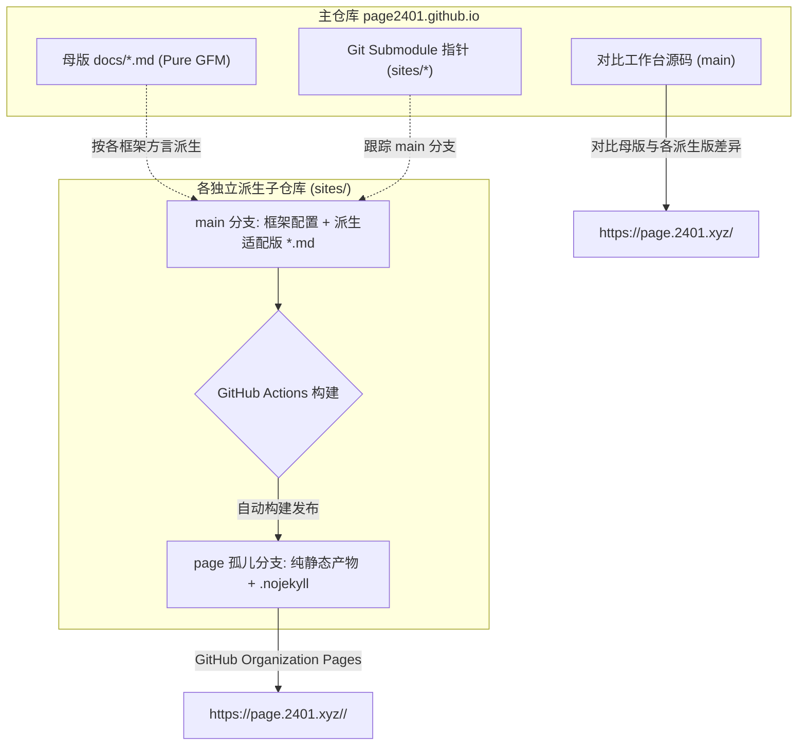
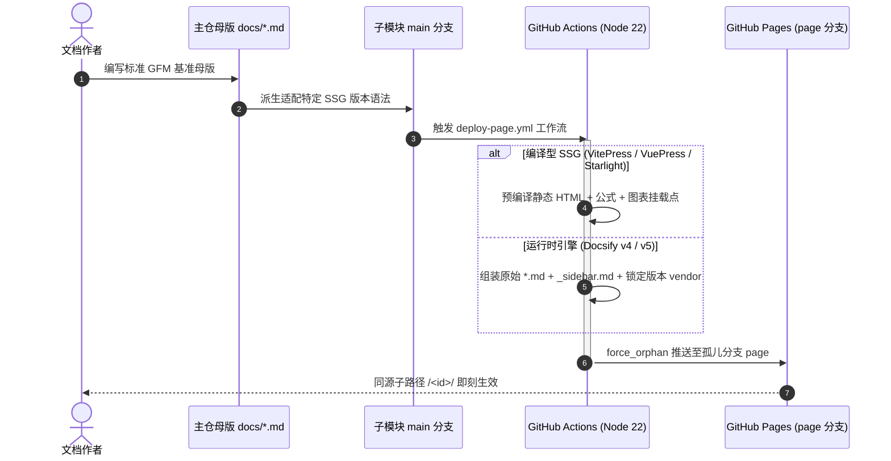
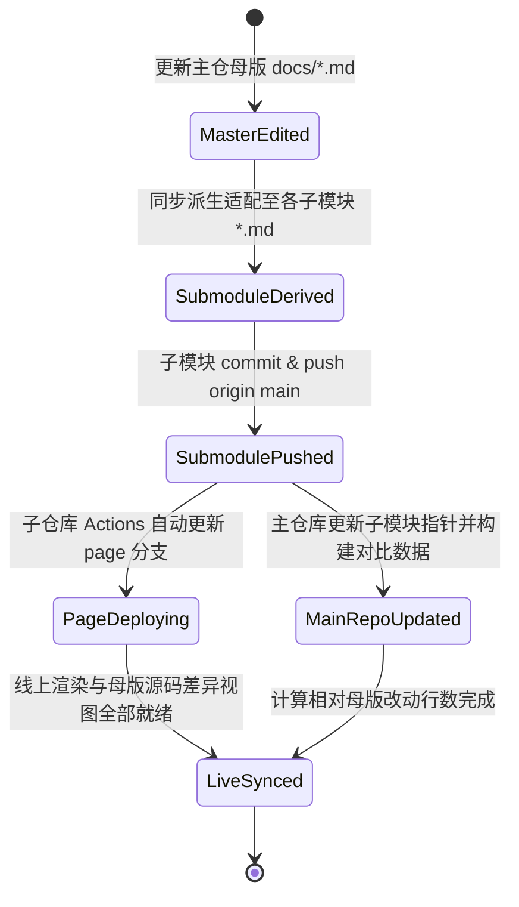

# 02. 流程图与时序图（前置过滤器拦截 + 按需本地 Mermaid）

在 Hexo `8.1.2` 默认配置下（`syntax_highlighter: highlight.js`），内置的 `backtick_code_block` 过滤器会在优先级 `10`（早于 Markdown 解析器！）将所有三反引号围栏代码块提前编译为 `<figure class="highlight">` 静态高亮表格。因此，本子站在 `scripts/markdown-enhancements.js` 中以**优先级 `5`** 注册 `before_post_render` 过滤器，在代码块被高亮吞噬前将 ```` ```mermaid ```` 安全封装进 `<hexoPostRenderCodeBlock>` 占位通道，并在 `layout.ejs` 中检测到图表时按需引入本地 `/hexo/vendor/mermaid.min.js`（`mermaid@12.3.0`），确保正文三段图表源码相对母版 **100% 零改动**。

## 1. 复杂子图与架构流程图（`flowchart TD`）

测试中文节点标签、子图嵌套（`subgraph`）、虚线边与条件分支：



## 2. 编译管线交互时序图（`sequenceDiagram`）

测试多参与者生命线、`alt` 分支块及激活框（`activate`/`deactivate`）：



## 3. 子模块同步状态机（`stateDiagram-v2`）

测试状态机语法与状态迁移说明标签：


